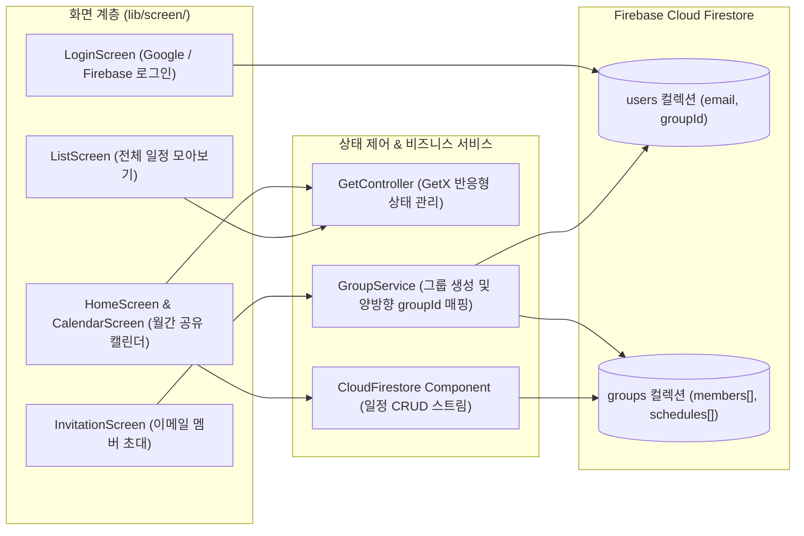

# 📅 Jo&A0 Diary (`joanda0` — 그룹 공유 캘린더 & 스케줄러 앱)


> **이메일 기반 그룹 초대로 커플·가족·소규모 팀을 하나의 공유 워크스페이스로 묶고, 날짜별 일정을 실시간 동기화하는 Flutter 멀티플랫폼 공유 캘린더 애플리케이션**

---

## 1. 목적 및 문제 정의 (Why)

개인 캘린더 앱은 혼자만의 일정을 기록하기에는 편리하지만, 커플이나 소규모 팀이 함께 일정을 조율할 때는 매번 일정을 캡처해 공유하거나 별도 캘린더 구독 권한을 복잡하게 설정해야 합니다.

`joanda0` (**Jo&A0 Diary**)는 **직관적인 이메일 기반 1:1/소규모 그룹 연결(`GroupService`)**과 **바텀시트 기반 빠른 일정 입력 UX**를 결합하여, 연결된 멤버들이 동일한 월간 캘린더와 오늘의 일정 배너를 실시간으로 함께 보고 편집할 수 있도록 제작된 크로스플랫폼 앱입니다.

---

## 2. 핵심 기능 및 해결 방식 (What)

1. **소셜/이메일 인증 (`screen/login_screen.dart`)**
   - `firebase_auth` 및 `google_sign_in`을 통해 간편 로그인을 처리하고 사용자 문서를 Firestore `users` 컬렉션과 연동합니다.
2. **이메일 기반 공유 그룹 생성 및 초대 (`component/groupservice.dart`)**
   - 상대방의 이메일로 `users` 컬렉션을 조회한 뒤, 발신자와 수신자를 멤버(`members`)로 포함하는 신규 `groups` 문서를 생성하고 양측 사용자의 `groupId`를 원자적으로 연결합니다.
3. **인터랙티브 월간 공유 캘린더 & 투데이 배너 (`main_calendar.dart`, `today_banner.dart`)**
   - 날짜 선택 시 해당 일자의 등록된 일정 개수(투데이 배너)와 상세 스케줄 카드 리스트(`selected_schedule_list.dart`, `schedule_card.dart`)를 즉시 렌더링합니다.
4. **바텀시트 일정 등록 및 전체 일정 리스트 뷰 (`schedule_bottom_sheet.dart`, `list_screen.dart`)**
   - 플로팅 액션 버튼을 통해 시작·종료 시간과 일정 내용을 커스텀 입력 필드(`custom_text_field.dart`)로 손쉽게 추가하고, 캘린더 뷰 외에 전체 일정을 모아보는 리스트 화면도 함께 제공합니다.

---

## 3. 시스템 아키텍처 및 디렉토리 구조 (How)

### 그룹 매칭 및 일정 동기화 아키텍처



### 디렉토리 구조

```text
joanda0/
├── lib/
│   ├── main.dart                         # Firebase 초기화, 로케일 날짜 포맷 설정 및 앱 루트 구동
│   ├── theme_data.dart                   # Jo&A0 전용 컬러 팔레트 및 Material 테마 정의
│   ├── const/colors.dart                 # 브랜드 주요 색상 상수
│   ├── controller/get_controller.dart    # GetX 기반 선택 날짜·그룹 상태 컨트롤러
│   ├── model/schedule_model.dart         # 일정 데이터 모델 직렬화/역직렬화 정의
│   ├── component/
│   │   ├── groupservice.dart             # 이메일 조회 기반 그룹 생성 및 멤버 연결 로직
│   │   ├── cloud_firestore.dart          # Firestore 일정 실시간 읽기/쓰기 래퍼
│   │   ├── main_calendar.dart            # 월간 캘린더 위젯
│   │   ├── today_banner.dart             # 선택 날짜 및 일정 건수 상단 배너
│   │   ├── schedule_card.dart            # 시간대별 개별 일정 카드 위젯
│   │   ├── selected_schedule_list.dart   # 선택 일자 스케줄 목록 뷰
│   │   ├── schedule_bottom_sheet.dart    # 신규 일정 입력 모달 바텀시트
│   │   └── custom_text_field.dart        # 시간/텍스트 입력 폼 검증 컴포넌트
│   └── screen/                           # login, home, calendar, invitation, list 화면 구성
├── android/ / ios/ / web/ / windows/ / macos/ / linux/  # Flutter 멀티플랫폼 타겟 스캐폴드
└── pubspec.yaml                          # 패키지 의존성 설정 (firebase_core, cloud_firestore, get, intl 등)
```

---

## 4. 로컬 실행 가이드 (Quick Start)

### 사전 요구 사항

- **Flutter SDK** (`3.x` 이상)
- Firebase 프로젝트 설정 (자체 개발/테스트 환경에서 구동 시 `flutterfire configure`로 새 `firebase_options.dart`를 생성하여 연결 가능)

### 설치 및 실행 명령어

```bash
# 1. 패키지 의존성 다운로드
flutter pub get

# 2. 코드 정적 분석 확인
flutter analyze

# 3. 원하는 타겟 디바이스(Android, iOS, Chrome, Windows 등)로 앱 실행
flutter run
```
